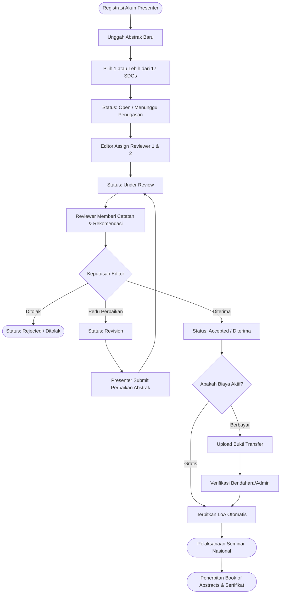

# Seminar Nasional Berdampak (SND)
**Badan Penelitian dan Pengabdian Masyarakat (BPPM) Fakultas Vokasi Universitas Brawijaya**

Sistem Informasi Manajemen Konferensi Ilmiah Nasional terintegrasi berbasis **17 Tujuan Pembangunan Berkelanjutan (Sustainable Development Goals / SDGs)**. Platform ini dirancang khusus untuk memfasilitasi alur pendaftaran, pengajuan abstrak, proses *peer-review*, penerbitan *Letter of Acceptance* (LoA), hingga kompilasi *Book of Abstracts* (Buku Kumpulan Abstrak) secara terstruktur, efisien, dan transparan.

---

## 📌 Karakteristik & Alur Utama Sistem

Sistem ini dikembangkan dengan alur terpadu yang telah disesuaikan dengan kebutuhan **Seminar Nasional Berdampak (SND)**:

1. **Submisi Berbasis Abstrak (Tanpa Full Paper)**  
   Fokus luaran pemakalah adalah abstrak ilmiah yang terkurasi. Tidak ada tahapan submisi maupun revisi *full paper*. Seluruh abstrak yang diterima (*accepted*) akan dikompilasi menjadi satu dokumen prosiding resmi (**Book of Abstracts**).
2. **Integrasi 17 Tema SDGs (Multi-Select Checkbox)**  
   Pada saat peserta (*Presenter*) mengunggah abstrak, sistem menyediakan pilihan 17 pilar SDGs PBB (Tanpa Kemiskinan, Pendidikan Berkualitas, Penanganan Perubahan Iklim, dll). Presenter dapat memilih **lebih dari satu SDG** yang relevan dengan topik makalahnya.
3. **Alur Revisi Terstruktur**  
   Jika Editor memberikan keputusan **`revision`**, presenter menerima notifikasi beserta catatan perbaikan resmi dari Editor & Reviewer. Presenter dapat langsung memperbarui abstrak melalui dashboard dan mengirimkan ulang perbaikan untuk ditinjau kembali hingga berstatus **`accepted`**.
4. **Sistem Biaya Dinamis & Fleksibel (Gratis / Berbayar)**  
   Admin memiliki kendali penuh melalui switch pengaturan:
   - **Status Gratis (Tahun Berjalan):** Peserta yang abstraknya dinyatakan *accepted* langsung berhak mengunduh *Letter of Acceptance* (LoA) secara otomatis tanpa melalui pintu pembayaran.
   - **Status Berbayar (Tahun Mendatang):** Sistem akan meminta pemakalah mengunggah bukti pembayaran pendaftaran (kategori Mahasiswa / Umum) sebelum dokumen LoA dapat diakses.

---

## 👥 5 Level / Role Pengguna

Aplikasi menerapkan sistem otorisasi berbasis peran (**Role-Based Access Control / RBAC**) menggunakan Laratrust:

| Role | Akses & Tanggung Jawab Utama |
| :--- | :--- |
| **`presenter`** | Mendaftarkan akun, mengirimkan abstrak + mencentang tema SDGs, memantau status telaah, mengirimkan revisi jika diminta, mengunduh LoA resmi, dan mengunduh sertifikat pemakalah. |
| **`editor`** | Menugaskan Reviewer 1 & 2 ke setiap naskah, memeriksa hasil ulasan reviewer, dan menetapkan keputusan akhir (*Accepted*, *Revision* + catatan umpan balik, atau *Rejected*). |
| **`reviewer`** | Meninjau naskah abstrak yang ditugaskan, memeriksa kesesuaian tema SDGs yang diklaim, serta memberikan rekomendasi (*Accept / Revision / Reject*) dan catatan review. |
| **`admin`** | Mengelola data peserta, mengonfigurasi kuota & jadwal submisi, mengaktifkan/menonaktifkan biaya pendaftaran, mengunduh kompilasi *Book of Abstracts*, dan manajemen sertifikat. |
| **`executive`** | Mengakses ringkasan eksekutif (*read-only dashboard*), memantau tren pendaftaran, sebaran tema SDGs, dan rekapitulasi data untuk pimpinan unit BPPM Vokasi UB. |

---

## 🔄 Diagram Alur Kerja (Workflow)



---

## 🛠️ Tumpukan Teknologi (Tech Stack)

- **Backend Framework**: [Laravel 11](https://laravel.com/) (PHP `^8.2`)
- **Frontend Architecture**: [Inertia.js React](https://inertiajs.com/) dengan [Vite 6](https://vitejs.dev/)
- **Autentikasi & RBAC**: Laravel Breeze & [Laratrust](https://laratrust.santigarcor.me/)
- **Styling & UI**: Tailwind CSS, Manrope Typography, [Iconify Icons](https://iconify.design/)
- **PDF Engine**: [Barryvdh DomPDF](https://github.com/barryvdh/laravel-dompdf) & [FPDI](https://github.com/Setasign/FPDI)
- **Database**: MySQL / MariaDB

---

## 🚀 Panduan Instalasi & Menjalankan Proyek

### 1. Prasyarat Sistem
Pastikan perangkat Anda telah terpasang:
- PHP `>= 8.2` (dengan ekstensi `pdo_mysql`, `mbstring`, `openssl`, `xml`, `curl`, `gd`)
- [Composer](https://getcomposer.org/) `>= 2.0`
- [Node.js](https://nodejs.org/) `>= 18.0` & NPM
- Layanan Database MySQL / MariaDB

### 2. Kloning & Instalasi Dependensi
```bash
# Masuk ke direktori proyek
cd /path/to/SND

# Instal dependensi backend (PHP)
composer install

# Instal dependensi frontend (Node.js)
npm install
```

### 3. Konfigurasi Environment
Salin file konfigurasi environment dan sesuaikan kredensial database Anda:
```bash
cp .env.example .env
```
Buka file `.env` dan atur koneksi database:
```dotenv
DB_CONNECTION=mysql
DB_HOST=127.0.0.1
DB_PORT=3306
DB_DATABASE=snd_database
DB_USERNAME=root
DB_PASSWORD=
```

Generate application key:
```bash
php artisan key:generate
```

Tautkan storage publik:
```bash
php artisan storage:link
```

### 4. Migrasi & Seeder Database
Jalankan migrasi seluruh tabel beserta master data (5 Role Laratrust, Master 17 SDGs, dan Pengaturan Awal Konferensi):
```bash
php artisan migrate:fresh --seed
```

### 5. Menjalankan Aplikasi (Mode Development)
Jalankan perintah praktis berikut untuk memulai seluruh layanan (Laravel + Queue + Vite) secara bersamaan:
```bash
composer run dev
```

*Atau dapat dijalankan secara terpisah pada dua jendela terminal:*
```bash
# Terminal 1: Web Server Laravel
php artisan serve

# Terminal 2: Vite Compiler
npm run dev
```
Aplikasi dapat diakses melalui browser di: **`http://localhost:8000`**

### 6. Build Asset untuk Production
```bash
npm run build
```

---

## 🔑 Kredensial Akun Default (Hasil Seeder)

Untuk keperluan pengujian lokal (*development*), database seeder telah menyediakan 5 akun uji coba untuk masing-masing level pengguna:

| Level / Peran | Alamat Email | Password |
| :--- | :--- | :--- |
| **Admin** | `admin@app.test` | `password` |
| **Editor** | `editor@app.test` | `password` |
| **Reviewer** | `reviewer@app.test` | `password` |
| **Presenter** | `presenter@app.test` | `password` |
| **Executive** | `executive@app.test` | `password` |

---

## 📁 Struktur Direktori Penting

```text
├── app/
│   ├── Http/Controllers/
│   │   ├── AbstractController.php            # Alur submisi, edit/revisi, LoA, dan sertifikat pemakalah
│   │   ├── DashboardController.php           # Routing dashboard sesuai peran pengguna
│   │   ├── Admin/
│   │   │   └── ConferenceSettingController.php # Pengaturan konferensi & toggle biaya gratis/berbayar
│   │   └── Reviewer/
│   │       ├── EditorController.php          # Penugasan reviewer & penetapan status keputusan naskah
│   │       └── ReviewController.php          # Form penilaian ulasan reviewer
│   └── Models/
│       ├── AbstractModel.php                 # Relasi naskah ke pengguna, reviewers, dan SDGs
│       ├── ConferenceSetting.php             # Atribut konfigurasi seminar & flag pembayaran
│       └── Sdg.php                           # Master data 17 SDGs PBB
├── config/
│   └── laratrust_seeder.php                  # Konfigurasi 5 level role dan permission Laratrust
├── database/
│   ├── migrations/                           # Skema tabel (sdgs, abstract_sdg, abstracts, dll.)
│   └── seeders/
│       ├── DatabaseSeeder.php                # Master runner seeder
│       ├── SdgSeeder.php                     # Seeder 17 data tema SDGs resmi
│       └── ConferenceSettingSeeder.php       # Seeder pengaturan default Seminar Nasional Berdampak
├── resources/
│   └── js/
│       ├── Components/ui/shared/             # Layout wrapper Inertia (User, Editor, Admin, Executive)
│       └── Pages/
│           ├── Admin/Settings/Index.jsx      # Panel pengaturan konferensi & switch pembayaran
│           ├── Editor/EditorAbstract/        # Antarmuka penugasan reviewer & form keputusan status
│           ├── Editor/ReviewAbstract/        # Antarmuka form telaah ulasan naskah
│           ├── User/Abstracts/Index.jsx      # Formulir multi-checkbox SDGs & riwayat submisi pemakalah
│           ├── User/Dashboard/Index.jsx      # Dashboard pemakalah (status abstrak, LoA, dan sertifikat)
│           └── layout/
│               ├── SidebarItemsUser.js       # Menu navigasi pemakalah (tanpa full paper)
│               └── SidebarItemsEditor.js     # Menu navigasi editor & reviewer
└── routes/
    └── web.php                               # Definisi seluruh rute aplikasi
```

---

## 📢 Catatan Pengembangan untuk Tim Magang (Landing Page)

Halaman utama (*landing page*) saat ini disiapkan untuk dikembangkan dan didesain ulang secara mandiri oleh tim mahasiswa magang:
- **Identitas Visual:** Sesuaikan branding visual, palet warna, logo institusi, dan tipografi dengan identitas **Badan Penelitian dan Pengabdian Masyarakat (BPPM) Fakultas Vokasi Universitas Brawijaya**.
- **Konten Panduan:** Hapus seluruh rujukan *Guideline Full Paper* lama dari menu navigasi maupun footer.
- **Section Tema SDGs:** Gantikan bagian *Objectives* lama dengan etalase pengenalan **17 Pilar SDGs** yang menjadi fokus utama Seminar Nasional Berdampak.

---

&copy; 2026 BPPM Fakultas Vokasi Universitas Brawijaya. Seluruh hak cipta dilindungi undang-undang.
